<div align="center">

# MYA Portfolio Project

**İçeriğini tamamen admin panelinden yönettiğim kişisel portfolyo sitem.**

[](https://dotnet.microsoft.com/)
[](https://learn.microsoft.com/aspnet/core/mvc/overview)
[](https://learn.microsoft.com/ef/core/)
[](https://www.microsoft.com/sql-server)
[](https://getbootstrap.com/)

<sub>M&Y Yazılım Eğitim Akademi · Portfolyo Projesi</sub>

</div>

---

## Proje Hakkında

Bu proje, M&Y Yazılım Eğitim Akademi'de verilen portfolyo case'i için hazırladığım bir ASP.NET Core MVC uygulaması. Sitede gördüğünüz her şey (hero alanındaki yazılar, yetenekler, deneyimler, projeler, eğitim bilgileri, sertifikalar ve iletişim bilgileri) veritabanından geliyor. Bunların hepsini `/Admin` altındaki yönetim panelinden ekleyip düzenleyebiliyorum, yani bir şeyi değiştirmek için koda dokunmam gerekmiyor.

Tasarımda sade, krem tonlarında bir arka plan ile adaçayı yeşili ve kiremit renklerini kullandım. Admin panelini de ayrı bir tema gibi düşünmek yerine sitenin renkleri ve yazı tipleriyle hazırladım ki iki taraf birbirinin devamı gibi dursun.

## İçindekiler

- [Ekran Görüntüleri](#ekran-görüntüleri)
- [Kullandığım Teknolojiler](#kullandığım-teknolojiler)
- [Kurulum](#kurulum)
- [Proje Yapısı](#proje-yapısı)
- [Admin Paneli](#admin-paneli)
- [Üzerinde Durduğum Noktalar](#üzerinde-durduğum-noktalar)
- [Eksikler ve Sonraki Adımlar](#eksikler-ve-sonraki-adımlar)

---

## Ekran Görüntüleri

### Site

**Ana sayfa.** Üstteki unvan, admin panelinden girdiğim ifadeler arasında yazılıp silinerek dönüyor.

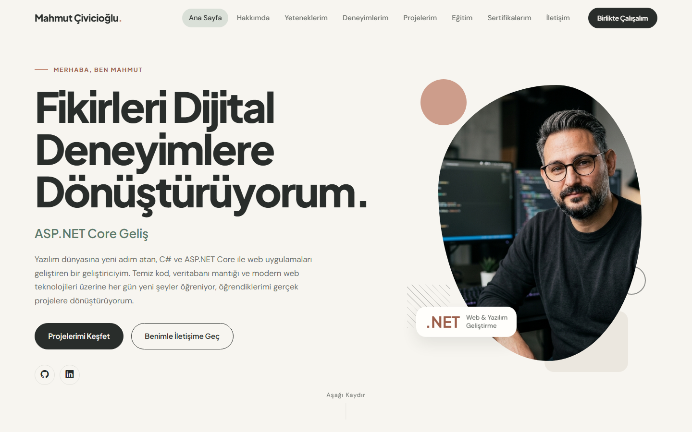

**Hakkımda.** Metindeki her satır sitede ayrı bir paragraf oluyor. Özgeçmiş yüklendiyse "Özgeçmişimi İncele" butonu çıkıyor.

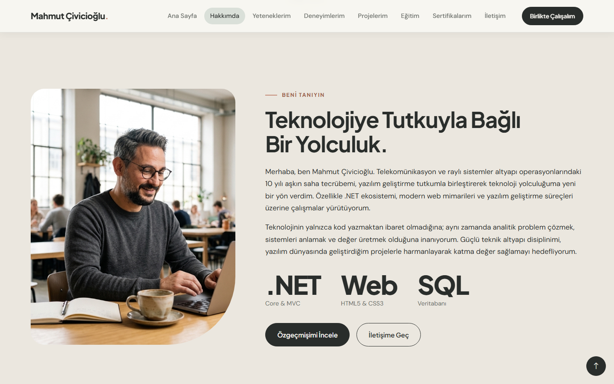

**Yetenekler**

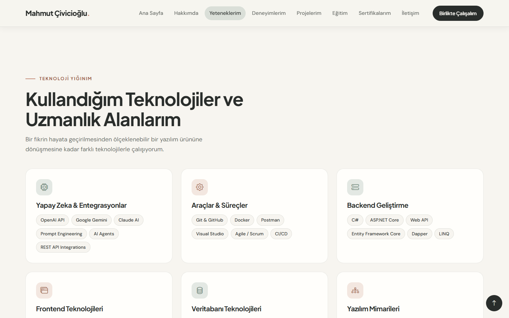

**Deneyimler.** Geniş ekranda iki taraflı bir zaman çizelgesi olarak görünüyor.

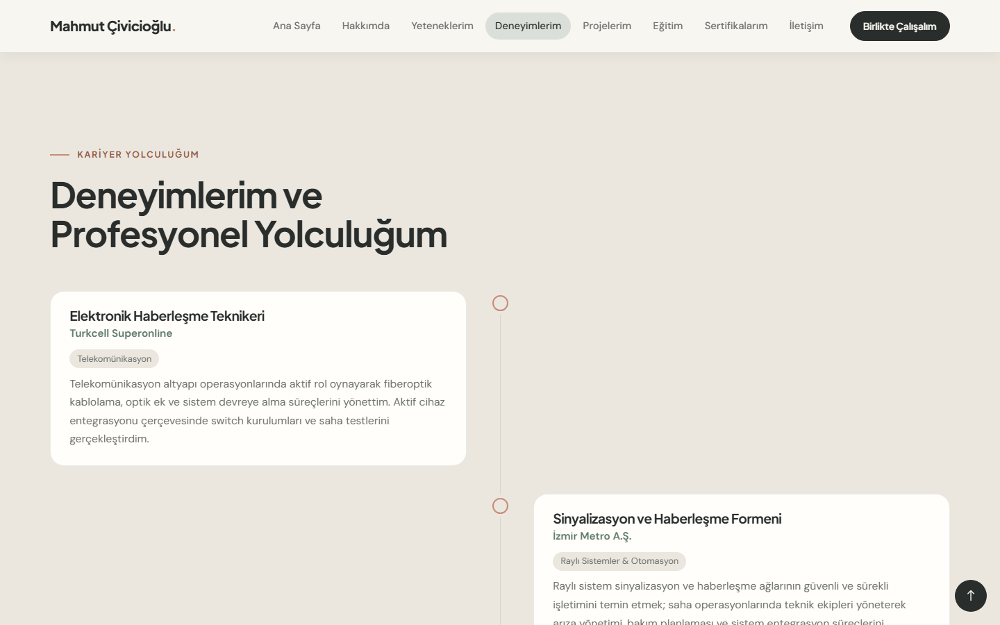

**Projeler.** Kategori filtresi ve sıralama sunucu tarafında çalışıyor.

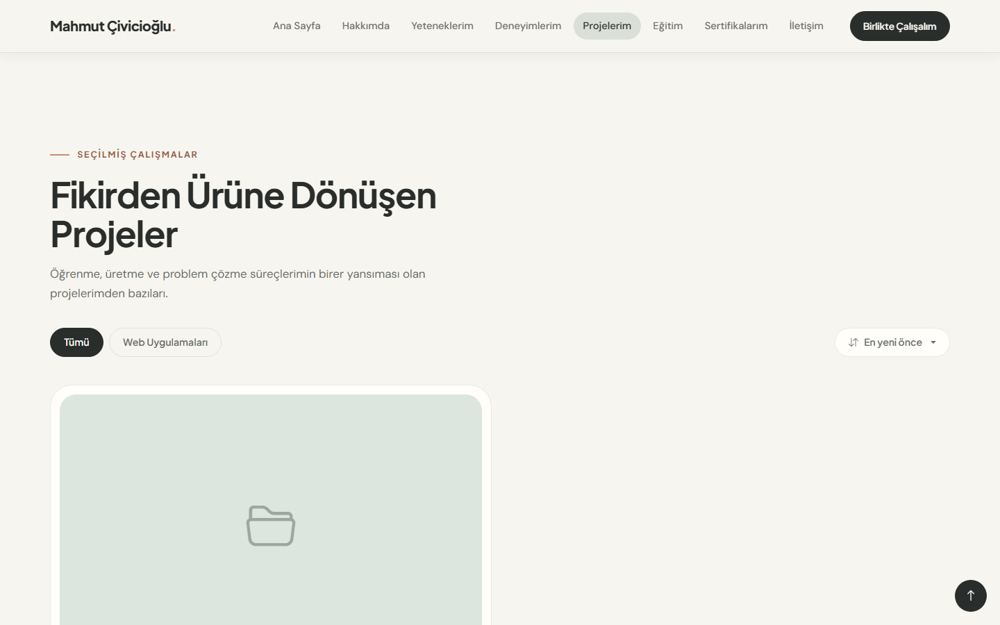

**Eğitim ve sertifikalar**

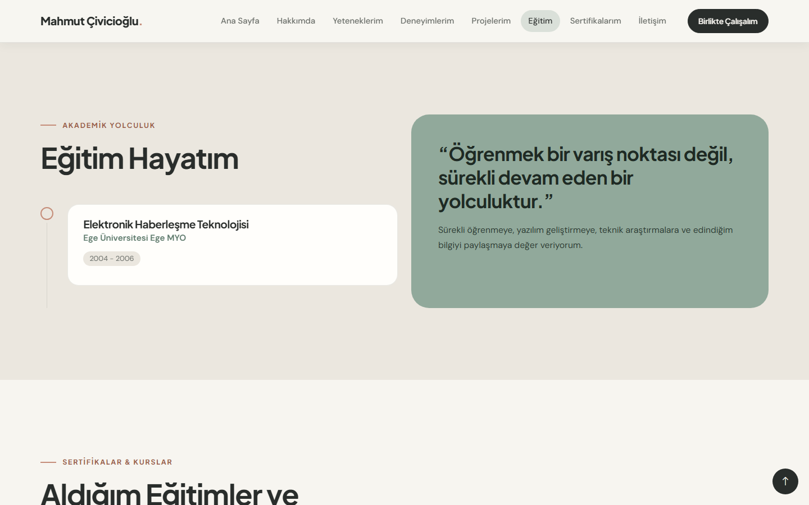

**İletişim.** Form, sayfa yenilenmeden gönderiliyor ve mesaj veritabanına kaydediliyor.

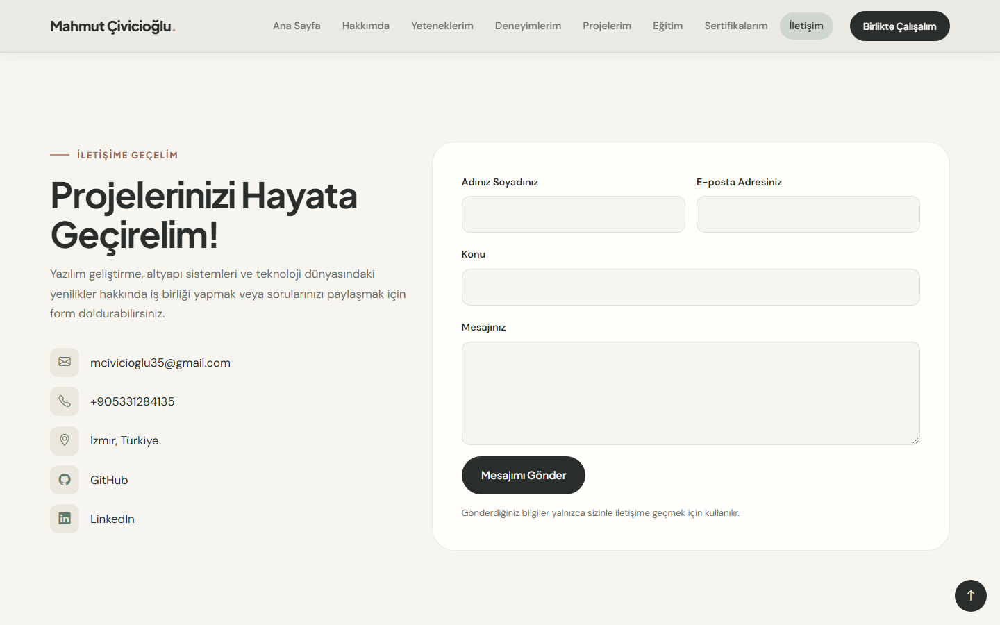

<details>
<summary><b>Mobil görünüm</b></summary>
<br>
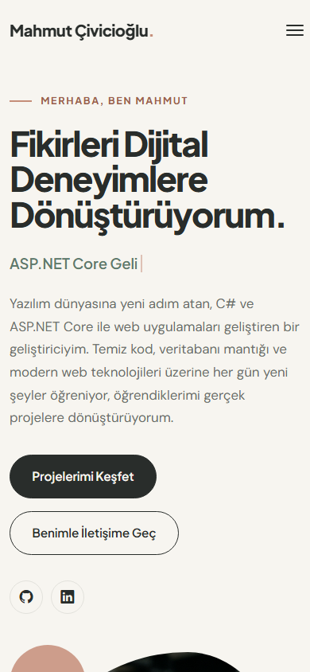
&nbsp;&nbsp;
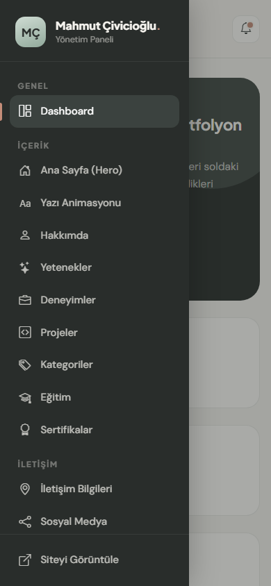
</details>

### Admin Paneli

**Dashboard.** Bölümlerin özet sayıları, son 7 günde gelen mesajlar, son mesajlar ve projeler aynı ekranda.

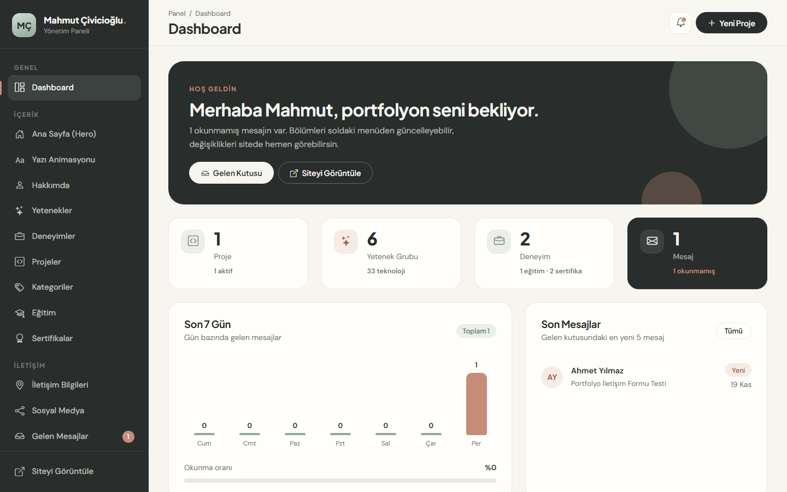

**Proje listesi**

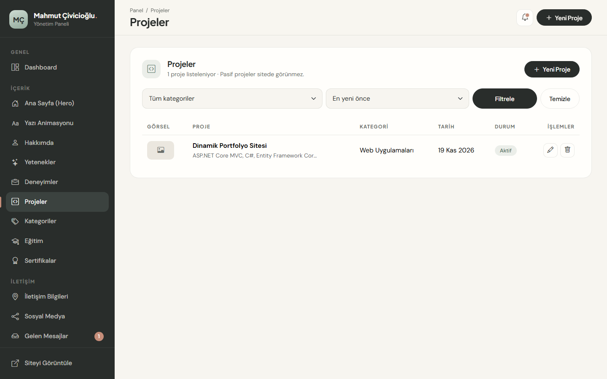

**Proje düzenleme.** Görseli seçer seçmez önizlemesi görünüyor.

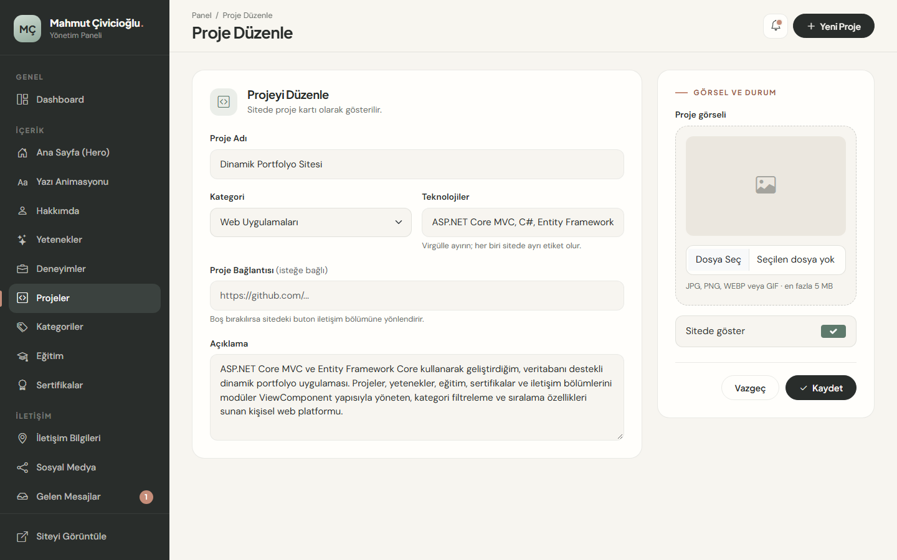

**Yetenek grubu düzenleme.** Gruba ait teknolojileri aynı sayfadan ekleyip düzenleyebiliyorum.

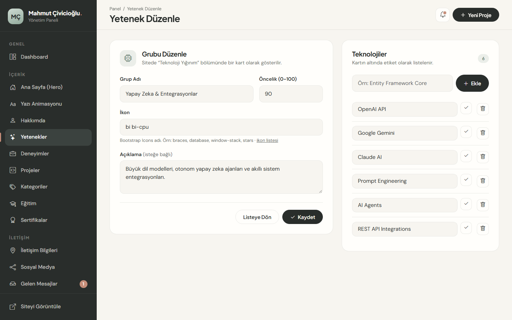

**Hakkımda formu.** Portre görseli ve PDF özgeçmiş buradan yükleniyor.

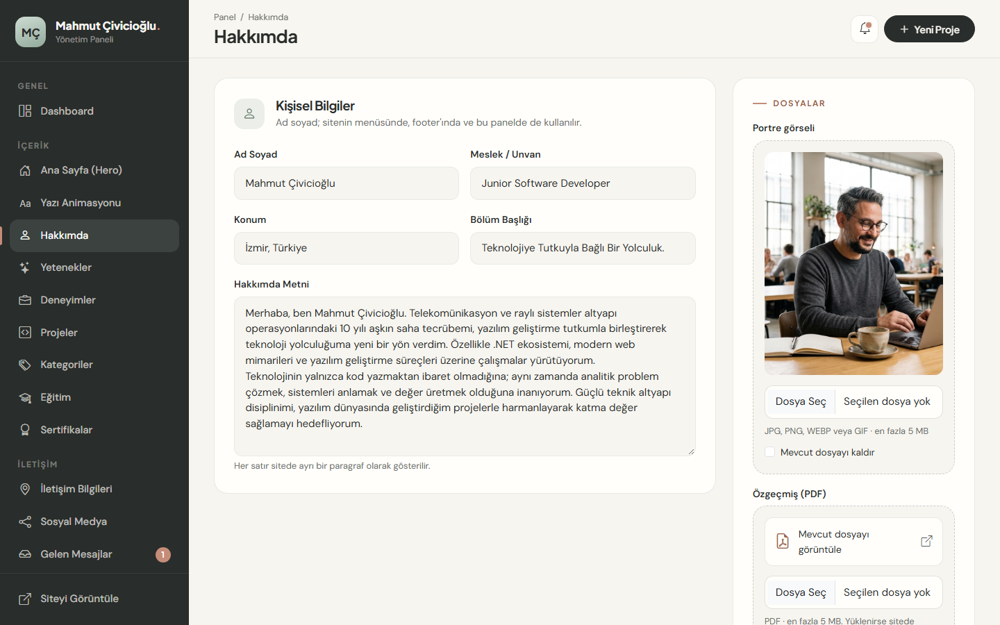

**Gelen kutusu ve mesaj detayı**

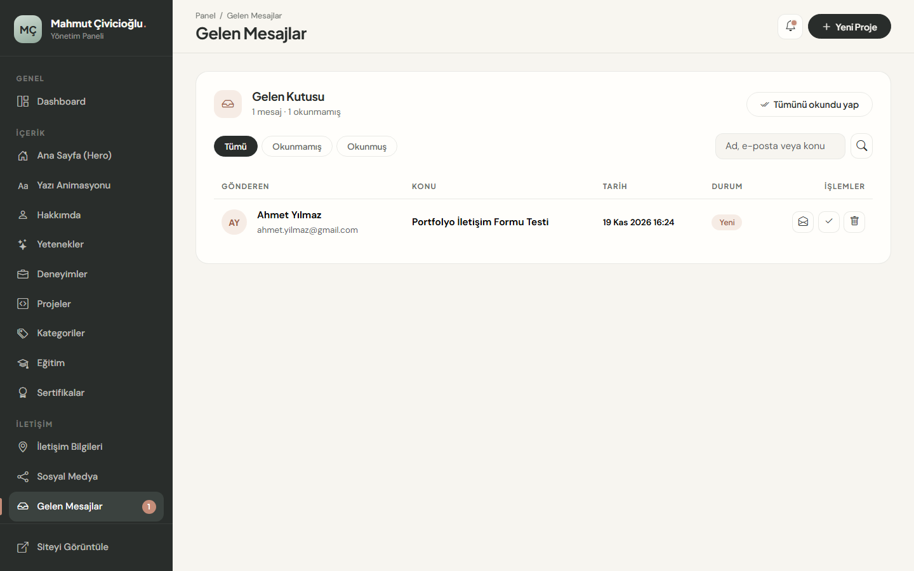

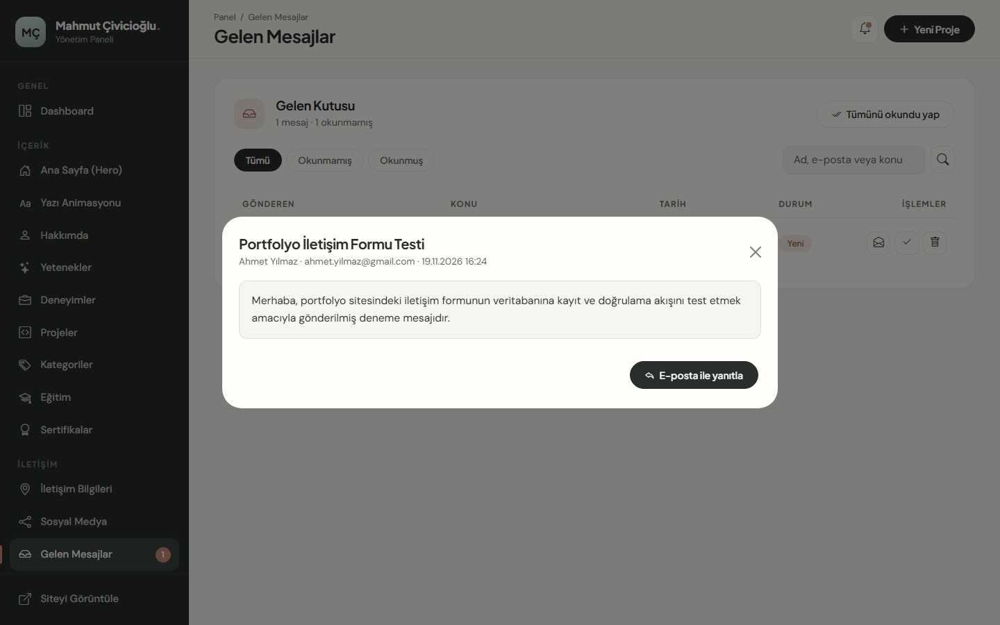

**Silme onayı.** Silme işlemleri doğrudan yapılmıyor, önce onay isteniyor.

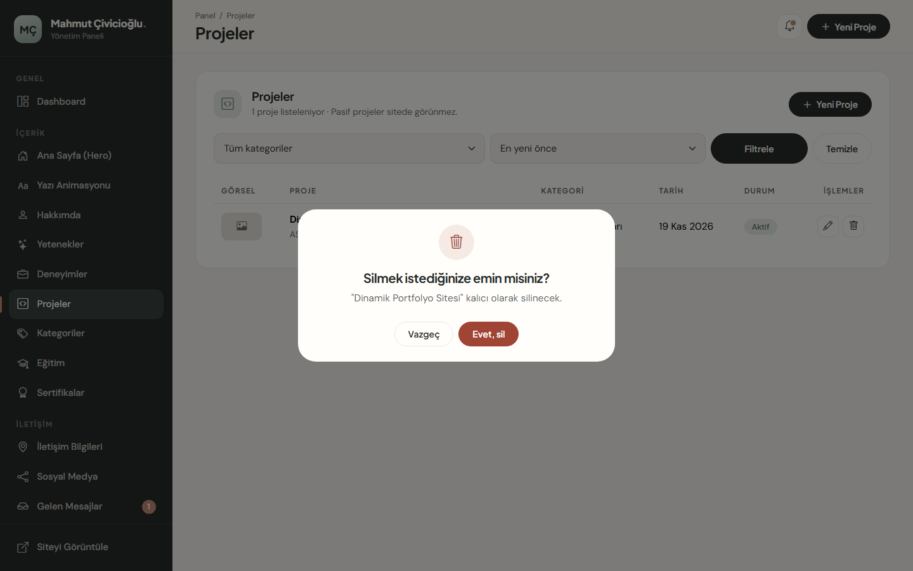

---

## Kullandığım Teknolojiler

| Alan | Teknoloji |
|---|---|
| Backend | C#, ASP.NET Core MVC (.NET 11) |
| Veri erişimi | Entity Framework Core 11 (Code First), SQL Server |
| Arayüz | HTML5, CSS3, Bootstrap 5.3, Bootstrap Icons, vanilla JavaScript |
| Yazı tipleri | Plus Jakarta Sans, DM Sans (Google Fonts) |
| Doğrulama | Data Annotations, jQuery Validation Unobtrusive |

---

## Kurulum

Gerekenler: .NET 11 SDK, SQL Server (Express veya LocalDB de olur) ve Visual Studio 2026.

1. Depoyu klonlayın:

   ```bash
   git clone https://github.com/mcivicioglu/MYA_PortfolioProject.git
   ```

2. `MYA_PortfolioProject/Context/PortfolioContext.cs` içindeki bağlantı dizesini kendi SQL Server bilgilerinize göre değiştirin. Şu an benim bilgisayarımdaki `.\TWildrunner` sunucusunu gösteriyor.

3. Veritabanını oluşturun. Visual Studio'da Package Manager Console'u açıp şunu çalıştırmanız yeterli:

   ```powershell
   Update-Database
   ```

   Komut satırını tercih ederseniz `dotnet ef database update` da aynı işi yapar (bunun için `dotnet-ef` aracının kurulu olması gerekiyor).

4. Projeyi çalıştırın (F5 veya `dotnet run`).

| Sayfa | Adres |
|---|---|
| Portfolyo sitesi | `/Default/Index` |
| Admin paneli | `/Admin` |

Boş bir veritabanıyla başlıyorsanız içerikleri şu sırayla girmenizi öneririm: **Hakkımda → Ana Sayfa (Hero) → İletişim Bilgileri → Sosyal Medya → Kategoriler → Projeler → Yetenekler → Deneyimler → Eğitim → Sertifikalar.** Kategori olmadan proje eklenemiyor, panel sizi önce Kategoriler sayfasına yönlendiriyor.

> [!NOTE]
> Yüklenen dosyalar `wwwroot/uploads/` klasörüne kaydediliyor. Bu klasör `.gitignore`'da olduğu için depoya gitmiyor; projeyi başka bir bilgisayarda açtığınızda görselleri yeniden yüklemeniz gerekir.

---

## Proje Yapısı

```
MYA_PortfolioProject/
├── Areas/Admin/
│   ├── Controllers/          # Her bölüm için bir controller, ortak taban: AdminBaseController
│   ├── Models/               # DashboardViewModel, FileInputModel
│   ├── ViewComponents/       # Admin layout parçaları (head, sidebar, navbar, style, script)
│   └── Views/                # XList / CreateX / UpdateX sayfaları ve ortak _XForm partial'ları
├── Context/                  # PortfolioContext (DbContext)
├── Controllers/              # Site tarafı: DefaultController, ContactController (iletişim formu)
├── Entities/                 # Veritabanı tabloları
├── Migrations/
├── Services/                 # FileService (dosya yükleme)
├── ViewComponents/           # Sitenin bölümleri (hero, hakkımda, yetenekler...)
└── Views/
    ├── Default/Index.cshtml  # Sitenin tek sayfası, bölümleri view component olarak çağırır
    └── Shared/Components/    # Her bölümün HTML'i
```

Sitenin ana sayfası tek bir HTML iskeletinden çıktı. Bu iskeleti bölümlere ayırıp her bölümü bir view component'e taşıdım. Böylece örneğin projeler bölümünü değiştirmek istediğimde sadece `_DefaultProjectComponentPartial` dosyasına bakmam yetiyor.

---

## Admin Paneli

| Bölüm | Panelde yapılabilenler | Sitedeki karşılığı |
|---|---|---|
| Dashboard | Özet sayılar, son 7 günün mesaj grafiği, son mesajlar ve projeler, kategori dağılımı, doldurulmamış bölüm uyarısı | – |
| Ana Sayfa (Hero) | Karşılama metni, başlık, açıklama, portre görseli | Sayfanın ilk açılan bölümü |
| Yazı Animasyonu | Unvan ekleme, sıralama, aktif/pasif yapma | Hero'da yazılıp silinen unvanlar |
| Hakkımda | Kişisel bilgiler, metin, portre görseli, PDF özgeçmiş | "Beni Tanıyın" bölümü; ad soyad menüde ve footer'da da kullanılıyor |
| Yetenekler | Grup ekleme ve düzenleme, ikon önizlemesi, gruba teknoloji ekleme | Teknoloji kartları ve etiketleri |
| Deneyimler | Ekleme, düzenleme, aktif/pasif | Zaman çizelgesi (sadece aktif olanlar) |
| Projeler | Ekleme, görsel yükleme, proje bağlantısı, kategori, aktif/pasif, filtreleme | Proje kartları ve kategori filtresi |
| Kategoriler | Ekleme, düzenleme, silme (içinde proje varsa silinemiyor) | Proje filtre butonları |
| Eğitim | Ekleme, düzenleme; bitiş yılı boşsa "Devam Ediyor" | Eğitim zaman çizelgesi |
| Sertifikalar | Ekleme, düzenleme; belge dosya olarak yüklenebiliyor ya da bağlantı verilebiliyor | Sertifika kartları (hiç yoksa bölüm gizleniyor) |
| İletişim Bilgileri | Başlık, açıklama, e-posta, telefon, konum | İletişim bölümü |
| Sosyal Medya | Bağlantı ekleme, ikon önizlemesi | Hero, iletişim ve footer'daki ikonlar |
| Gelen Mesajlar | Okunmuş/okunmamış filtresi, arama, mesajı pencerede okuma, e-postayla yanıtlama, silme | İletişim formundan gelenler |

---

## Üzerinde Durduğum Noktalar

**Dosya yükleme**

Bütün yüklemeler tek bir servisten (`Services/FileService.cs`) geçiyor. Dosya uzantısının yanında dosyanın ilk birkaç baytına da bakıyorum; uzantısı `.png` yapılmış bir metin dosyası bu sayede reddediliyor. İçine script gömülebildiği için SVG'ye izin vermedim. Dosyalar rastgele bir adla (`Guid`) kaydediliyor ve veritabanında sadece yolları tutuluyor. Bir görsel değiştirildiğinde ya da kayıt silindiğinde eski dosyayı da diskten siliyorum, böylece `uploads` klasöründe sahipsiz dosya birikmiyor. Silme işlemi `uploads` klasörünün dışına çıkamıyor.

Bir de küçük bir ayrıntı: .NET'in yeni `MapStaticAssets()` yöntemi sadece derleme sırasında var olan dosyaları sunuyor. Panelden sonradan yüklenen görseller bu yüzden açılmıyordu, `Program.cs`'e `UseStaticFiles()` ekleyerek çözdüm.

**İletişim formu**

Form `fetch` ile gönderiliyor, sayfa yenilenmiyor. Hata olursa sunucunun döndürdüğü mesaj ilgili alanın altında görünüyor. Spam için görünmeyen bir "honeypot" alanı koydum; bu alan doluysa mesaj kaydedilmeden başarılı yanıt dönüyor. Gönderim tarihi ve okundu bilgisi formdan alınmıyor, sunucuda atanıyor.

**Güvenlik ve veri bütünlüğü**

- Bütün POST işlemlerinde anti-forgery token var; silme işlemleri GET ile yapılamıyor.
- Güncellemelerde formdan gelen nesneyi doğrudan kaydetmek yerine alanları tek tek kopyalıyorum. Böylece projenin oluşturulma tarihi gibi formda olmayan alanlar ezilmiyor.
- Veritabanında kategori silinince projeleri de silinecek şekilde (cascade) bir ilişki var. Yanlışlıkla proje kaybetmemek için içinde proje olan bir kategorinin silinmesini engelledim.

**Admin paneli yapısı**

Bütün admin controller'ları `AdminBaseController`'dan türüyor. Area tanımı, DbContext, dosya servisi ve bildirim mesajları orada toplu duruyor. Ekleme ve güncelleme sayfaları aynı form partial'ını kullanıyor, yani bir alana değişiklik yaptığımda iki ayrı sayfayı düzeltmem gerekmiyor.

---

## Eksikler ve Sonraki Adımlar

- **Admin paneline giriş yok.** Şu an `/Admin` adresini bilen herkes paneli açabilir. Siteyi yayına almadan önce mutlaka kullanıcı girişi ekleyeceğim.
- Bağlantı dizesi kodun içinde duruyor. `appsettings.json` dosyasına ya da ortam değişkenine taşınması gerekiyor.
- Sitenin adresi (`/`) hâlâ şablondan gelen Home sayfasını açıyor. Doğrudan portfolyoya yönlendirmem lazım.
- Deneyimler için ayrı başlangıç ve bitiş tarihi alanı yok. Tarih aralığını şimdilik etiket alanına yazıyorum.
- Hakkımda bölümündeki istatistikler ve hero'daki ".NET" rozeti sabit; bunları da panelden yönetilebilir yapmak istiyorum.

---

<div align="center">

Geliştiren: **Mahmut Çivicioğlu** · [GitHub](https://github.com/mcivicioglu) · [LinkedIn](https://www.linkedin.com/in/mahmutcivicioglu/)

</div>
